# Design polish golden images

Generated by the golden tests (Linux, final frame, mascot shown as its
still poster because the 3D WebView cannot render in tests). Icons in
some screens show as empty boxes only because the test font has no icons.

Removed: `accounts_empty.png` (replaced by `accounts_empty_illustration.png`).

## All 11 illustrations (new)

## Home with mascot (poster) (new)

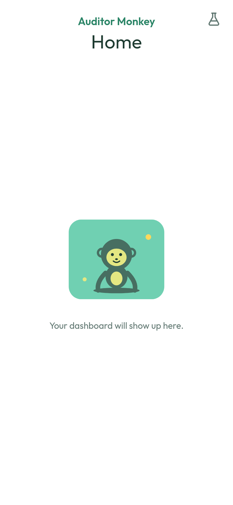

## Demo data ribbon (new)

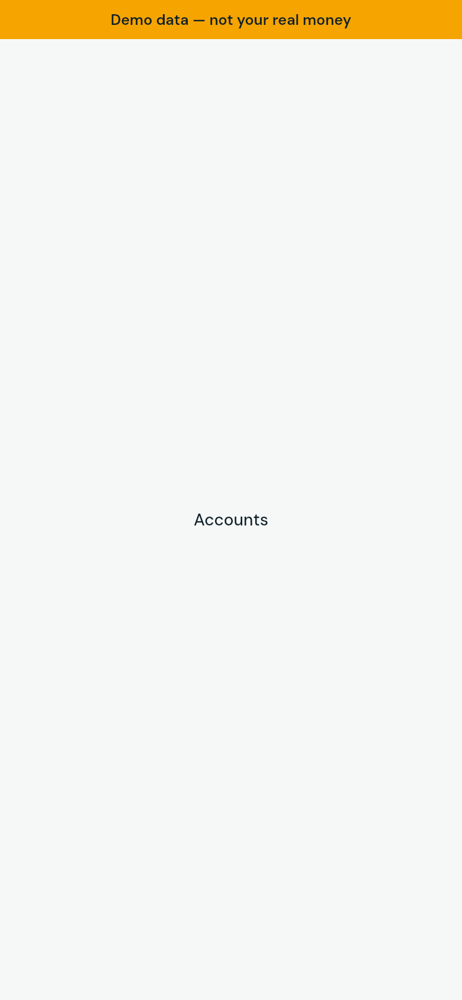

## Error state (generic) (new)

## Accounts empty (illustration) (new)

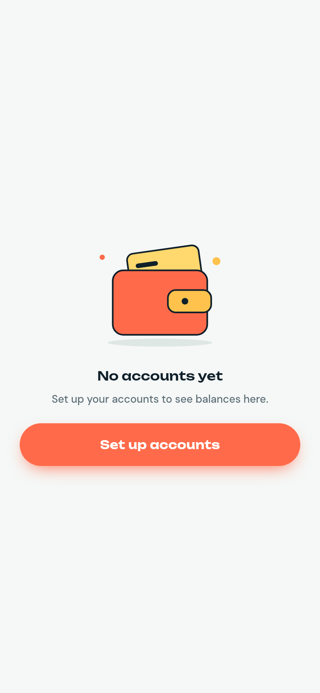

## Statement empty (illustration) (new)

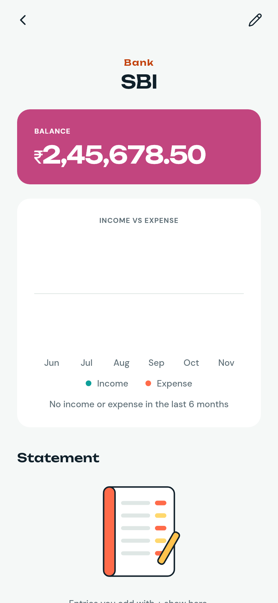

## Wizard done (celebrating mascot) (new)

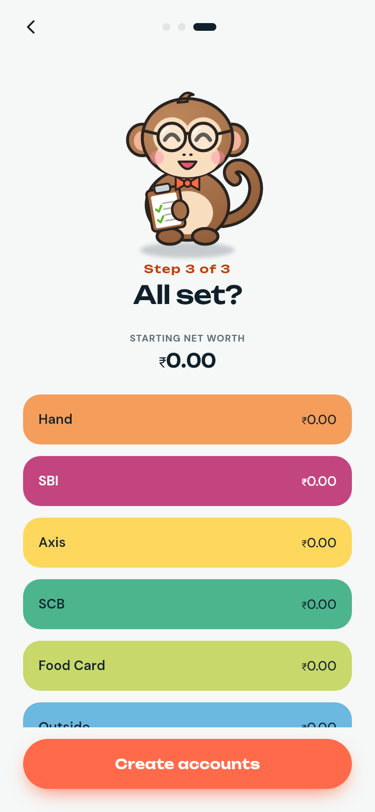

## Wizard welcome (mascot) (updated)

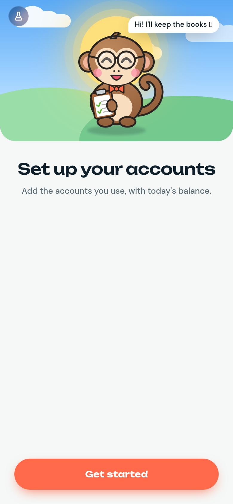

## Wizard pick (updated)

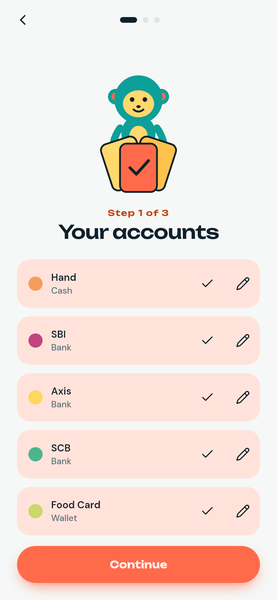

## Wizard balances (updated)

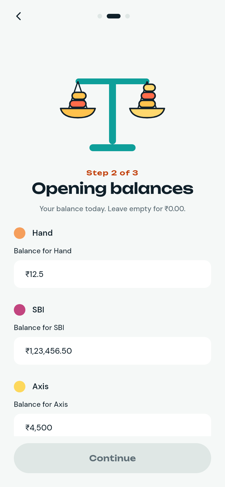

## Wizard balances (owes) (updated)

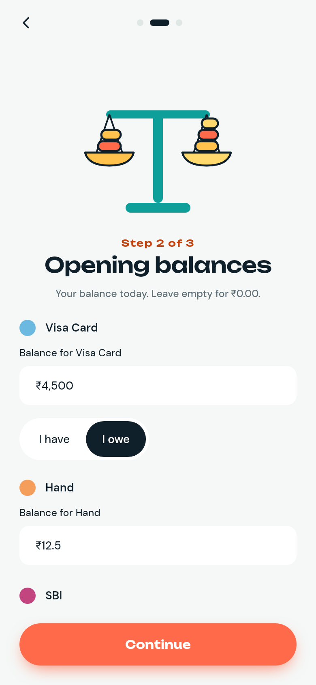

## Wizard review (updated)

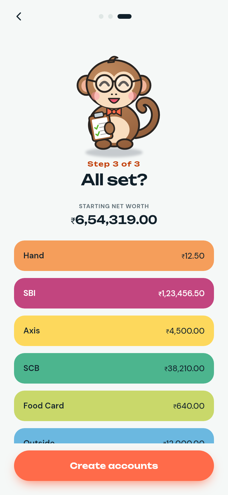

## Wizard review error (updated)

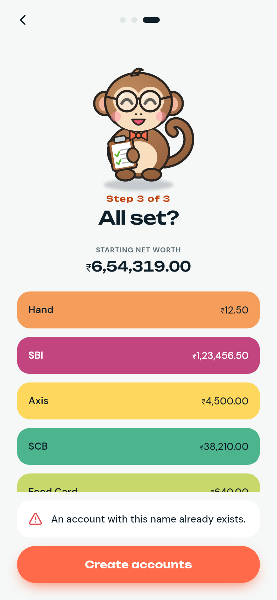

## Quick Add saved toast (success check) (updated)

## Quick Add load error (updated)

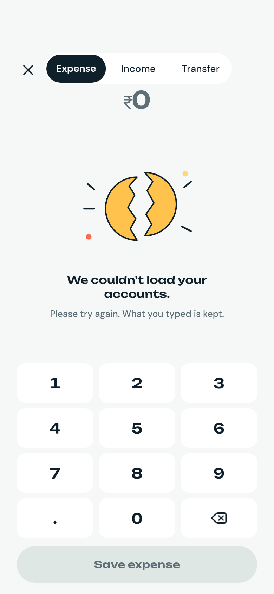

## Accounts error (updated)

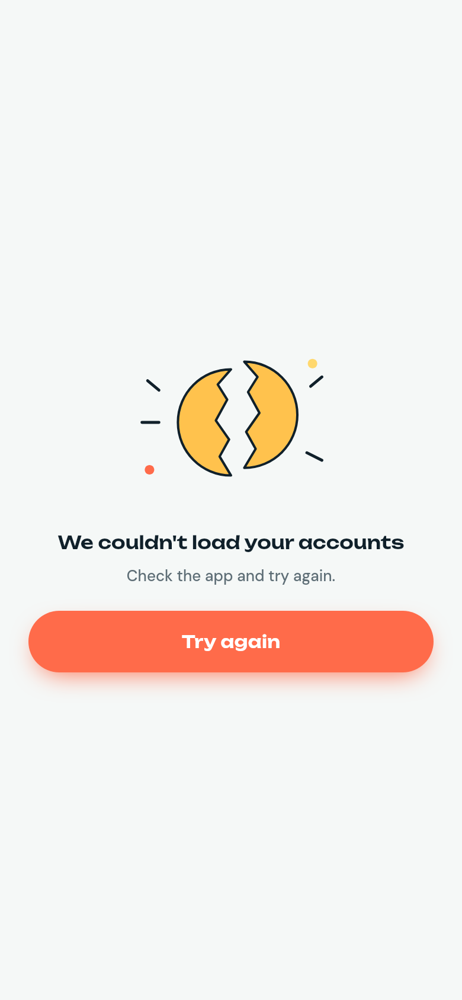

## Start screen error (updated)

